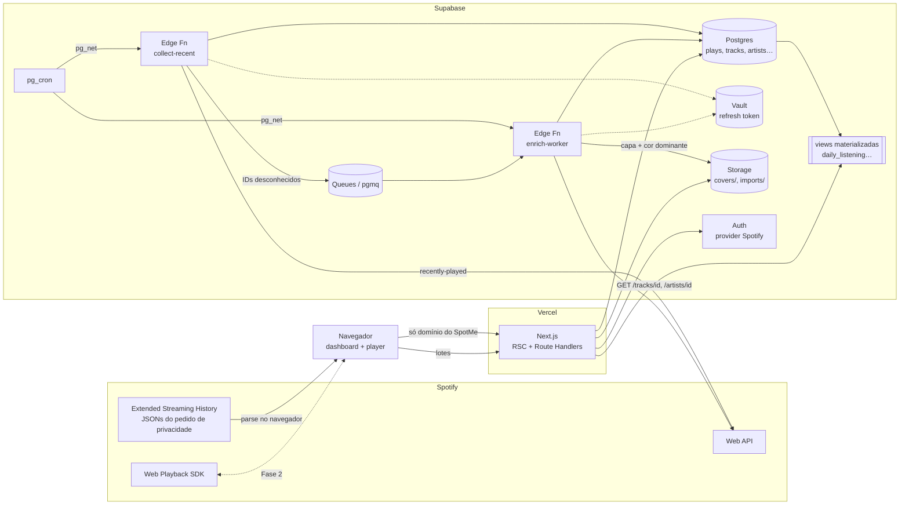

# Arquitetura

Stack e motivos em [`STACK.md`](STACK.md). Tabelas em [`DATA_MODEL.md`](DATA_MODEL.md).
Restrições da plataforma Spotify em [`SPOTIFY_PLATFORM.md`](SPOTIFY_PLATFORM.md).

## Visão geral



Regra de ouro: **o navegador só conversa com o SpotMe** (Vercel + Supabase).
Quem fala com o Spotify é o backend. A única exceção é o player da Fase 2,
que por natureza precisa alcançar os domínios do Spotify.

## Monorepo

```
spotme/
├── apps/
│   └── web/                     # Next.js 16 — dashboard, BFF, OAuth, import, player
│       └── src/
│           ├── app/             # rotas (ver DESIGN.md › Telas)
│           ├── components/      # shell, componentes do domínio
│           ├── features/        # dashboard/, history/, import/, player/, sync/
│           └── server/          # acesso a dados (queries Drizzle), auth helpers
├── packages/
│   ├── core/                    # TS puro, sem I/O: regras de métrica, estimativa,
│   │                            #   dedup, formatDuration, parsers + schemas zod
│   ├── db/                      # schema Drizzle, migrations, queries de agregação
│   ├── spotify/                 # cliente tipado da Web API (fetch puro, roda em Node e Deno)
│   ├── ui/                      # design system (shadcn/Base UI, tokens, Ds*)
│   └── config/                  # tsconfig, biome/eslint compartilhados
├── supabase/
│   ├── config.toml
│   ├── migrations/              # geradas pelo drizzle-kit + SQL manual (cron, RLS, views)
│   └── functions/
│       ├── collect-recent/      # importa de ../../packages/spotify e ../../packages/core
│       ├── enrich-worker/
│       └── _shared/
├── docs/
├── PRODUCT.md
└── DESIGN.md
```

`packages/core` e `packages/spotify` **não podem** depender de APIs de Node
(fs, Buffer…) — são importados também pelas Edge Functions (Deno).

## Fluxos

### 1. Login e token

1. Usuária clica "Entrar com Spotify" → Supabase Auth (provider Spotify) com os
   scopes de [`SPOTIFY_PLATFORM.md`](SPOTIFY_PLATFORM.md#scopes).
2. No callback (`/auth/callback`), o servidor:
   - confere se o Spotify user ID é o de `ALLOWED_SPOTIFY_USER_ID` — se não for,
     desloga e recusa;
   - pega `provider_refresh_token` da sessão e grava no **Vault** (via RPC
     `security definer`), referenciado por `spotify_accounts.refresh_token_secret_id`.
3. Daí em diante, só o backend gera access tokens (refresh). Se o Spotify
   devolver um refresh token novo na renovação, ele substitui o antigo no Vault.
4. Se o refresh falhar com `invalid_grant`, o coletor marca a conta como
   `needs_reauth` e o dashboard mostra um aviso para logar de novo.

### 2. Coleta de reproduções recentes (`collect-recent`)

- `pg_cron` a cada **20 min** chama a função via `pg_net` (header com segredo
  próprio, não a service key).
- A função:
  1. renova o access token;
  2. `GET /me/player/recently-played?limit=50&after=<cursor_ms>`;
  3. faz upsert de tracks/álbuns/artistas com o que veio no payload (o objeto
     de track já traz álbum e artistas simplificados);
  4. insere em `plays` com `source='recent_api'`, `ms_played_estimated=true`,
     `ON CONFLICT DO NOTHING`;
  5. atualiza `spotify_accounts.recent_cursor` e grava `collector_runs`;
  6. enfileira em `enrich` os artistas/álbuns sem detalhes completos.
- **Detecção de lacuna:** se vieram 50 itens e o mais antigo é mais novo que o
  cursor anterior, houve buraco. Registra em `collector_runs.gap_detected` →
  o dashboard mostra `CollectorStatus` em alerta.
- Tempo estimado: calculado depois, em lote, pela regra de
  [`DATA_MODEL.md`](DATA_MODEL.md#estimativa-de-tempo).

### 3. Importação do Extended Streaming History

1. Usuária pede os dados em spotify.com → Privacidade → "Histórico de
   streaming estendido" (chega em até ~30 dias) e baixa o zip.
2. Em `/importar`, ela arrasta o zip ou os `Streaming_History_Audio_*.json`.
3. Um **Web Worker** no navegador descompacta, valida com zod (schemas em
   `packages/core/import`), **descarta `ip_addr`** e campos que não usamos, e
   manda lotes de ~2 000 linhas para `POST /api/import/batches`.
4. O Route Handler, numa transação por lote:
   - cria tracks "stub" a partir de `spotify_track_uri` + nomes em texto;
   - insere `plays` com `source='extended_history'`, `ms_played` exato;
   - aplica a regra de dedup (Extended History vence `recent_api` na mesma
     janela);
   - enfileira tracks desconhecidas em `enrich`.
5. `import_jobs` guarda progresso e o resumo (inseridas / duplicadas /
   ignoradas: podcast, `ms_played = 0`, sem URI).

Reimportar o mesmo arquivo é seguro (idempotente).

### 4. Enriquecimento (`enrich-worker`)

- `pg_cron` a cada minuto chama a função se a fila `enrich` não estiver vazia.
- Cada execução lê até N mensagens (cabendo folgado nos 150 s da Edge
  Function), e para cada uma faz **um** `GET /tracks/{id}` / `/artists/{id}` /
  `/albums/{id}` (sem endpoints em lote no modo dev).
- Em `429`, respeita `Retry-After`, devolve a mensagem para a fila com
  visibilidade atrasada e encerra a execução.
- Ao enriquecer um álbum: baixa a capa (300 px e 640 px), salva em
  `storage/covers/{album_id}_{size}.jpg`, extrai a cor dominante e grava em
  `albums.dominant_color`.

### 5. Agregações

- Views materializadas (`daily_listening`, `daily_artist_listening`,
  `daily_track_listening`) por dia civil no fuso da usuária.
- `REFRESH MATERIALIZED VIEW CONCURRENTLY` disparado ao final de cada coleta,
  lote de import e lote de enriquecimento (debounce: no máximo 1×/min).
- "Hoje" lê direto de `plays` (pouco volume, precisa ser fresco).
- Semana/mês/ano/retrospectiva leem das views.

### 6. Player integrado (Fase 2)

- `GET /api/spotify/token` devolve um access token curto (scope `streaming`)
  para o SDK; o refresh nunca sai do servidor.
- O SDK registra o dispositivo "SpotMe"; controles via SDK + endpoints de
  playback da Web API.
- Eventos `player_state_changed` são resumidos no cliente em segmentos
  (track, início, ms tocados) e enviados para `POST /api/player/events`, que
  grava `plays` com `source='web_player'` e tempo **exato**. Na dedup,
  `web_player` vence `recent_api` (a mesma reprodução aparece nos dois).

### 7. Sync com YouTube Music (Fase 3)

Esboço — detalhar após o spike:
`sync-playlists` (cron diário) lê playlists do Spotify → para cada faixa sem
vínculo, gera candidatos no YouTube (busca, consumindo quota) → match
automático só acima de um limiar de confiança; o resto vai para
`yt_match_reviews` (tela de conflitos) → insere nas playlists espelho
respeitando a quota diária, continuando no dia seguinte se acabar.

## Segurança e privacidade

- **RLS ligado em todas as tabelas**, políticas `user_id = auth.uid()`. Mesmo
  sendo uma usuária só, isso evita vazamento se a anon key for usada errado.
- Service role só dentro das Edge Functions e do servidor Next.
- Refresh tokens (Spotify, depois Google) só no **Vault**.
- Allowlist de Spotify user ID no login.
- `ip_addr` e `conn_country` do Extended History não são armazenados
  (`conn_country` pode ser reavaliado se virar métrica de viagem).
- Funções chamadas pelo cron exigem `x-cron-secret`.

## Variáveis de ambiente

| Variável | Onde | Para quê |
|---|---|---|
| `NEXT_PUBLIC_SUPABASE_URL`, `NEXT_PUBLIC_SUPABASE_ANON_KEY` | web | cliente Supabase |
| `SUPABASE_SERVICE_ROLE_KEY` | web (server), functions | escrita privilegiada |
| `DATABASE_URL` | web (server), drizzle-kit | conexão Postgres (pooler) |
| `SPOTIFY_CLIENT_ID`, `SPOTIFY_CLIENT_SECRET` | functions, web (server), Supabase Auth | OAuth e refresh |
| `ALLOWED_SPOTIFY_USER_ID` | web (server) | allowlist |
| `CRON_SECRET` | functions, SQL do cron (via Vault) | autenticar chamadas do cron |
| `APP_TIMEZONE` | web, functions | padrão `America/Sao_Paulo` |
