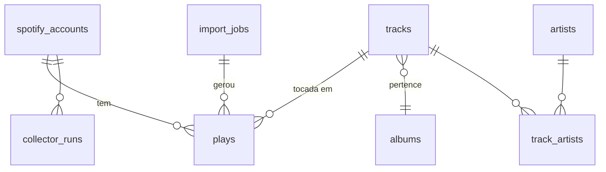

# Modelo de dados

Conceitual — o schema real vive em `packages/db/src/schema.ts` (Drizzle).
Todas as tabelas com `user_id` têm RLS `user_id = auth.uid()`.
Timestamps sempre `timestamptz` em UTC; o fuso só entra nas agregações.

## Entidades



### `spotify_accounts`

| Coluna | Tipo | Nota |
|---|---|---|
| `user_id` | uuid PK → `auth.users` | |
| `spotify_user_id` | text unique | conferido contra a allowlist |
| `display_name`, `product` | text | `product = 'premium'` é pré-requisito do player |
| `scopes` | text[] | scopes concedidos de fato |
| `refresh_token_secret_id` | uuid | id do segredo no Vault |
| `recent_cursor` | timestamptz | `played_at` mais novo já coletado |
| `status` | enum `ok` · `needs_reauth` · `paused` | |
| `timezone` | text | padrão `America/Sao_Paulo` |

### `tracks`

| Coluna | Tipo | Nota |
|---|---|---|
| `id` | text PK | Spotify track ID (o final do `spotify:track:…`) |
| `name` | text | |
| `duration_ms` | int null | null até enriquecer (stub do import) |
| `album_id` | text null → `albums` | |
| `primary_artist_name_raw` | text | nome em texto vindo do Extended History; fallback de ranking até enriquecer |
| `album_name_raw` | text | idem |
| `explicit` | bool null | |
| `enriched_at` | timestamptz null | null = está/vai para a fila |

### `albums`

`id` text PK · `name` · `release_date` text (precisão varia: ano, mês ou dia) ·
`cover_path_300`, `cover_path_640` (caminhos no Storage) · `dominant_color`
text (oklch) · `enriched_at`.

### `artists`

`id` text PK · `name` · `image_path` · `dominant_color` text (oklch) · `genres` text[] null (pode não vir no modo
dev; não depender disso) · `enriched_at`.

### `track_artists`

`track_id` · `artist_id` · `position` (0 = principal). PK (`track_id`, `artist_id`).

### `plays` — a tabela central

| Coluna | Tipo | Nota |
|---|---|---|
| `id` | bigint identity PK | |
| `user_id` | uuid | |
| `track_id` | text → `tracks` | |
| `played_at` | timestamptz | **momento em que a reprodução terminou** (ver "Pontos a validar") |
| `ms_played` | int | exato ou estimado |
| `ms_played_estimated` | bool | `true` para `recent_api` até ser substituído |
| `source` | enum `recent_api` · `extended_history` · `web_player` | |
| `import_job_id` | uuid null | |
| `platform` | text null | só do Extended History (ex.: `android`, `windows`) |
| `reason_start`, `reason_end` | text null | idem (`trackdone`, `fwdbtn`…) |
| `shuffle`, `skipped`, `offline` | bool null | idem |
| `context_uri` | text null | playlist/álbum de onde tocou (recent_api) |

Índices: unique (`user_id`, `track_id`, `played_at`); (`user_id`, `played_at`
desc); (`user_id`, `track_id`).

Podcasts e audiobooks do Extended History **não entram em `plays`** no v1
(contados como "ignorados" no `import_jobs`). Se um dia virarem feature, ganham
tabela própria — não misturar com música.

### `import_jobs`

`id` uuid · `user_id` · `status` (`running` · `done` · `failed`) · `files` text[]
· `rows_total`, `rows_inserted`, `rows_duplicate`, `rows_ignored` · `range_start`,
`range_end` timestamptz · `error` text · `created_at`, `finished_at`.

### `collector_runs`

`id` · `user_id` · `started_at` · `finished_at` · `items_fetched` ·
`items_inserted` · `gap_detected` bool · `error` text. Mantém ~90 dias.

### Views materializadas

| View | Grão | Colunas |
|---|---|---|
| `daily_listening` | usuária × dia | `ms_played`, `ms_estimated`, `plays_counted`, `distinct_tracks`, `distinct_artists` |
| `daily_artist_listening` | usuária × dia × artista | `ms_played`, `plays_counted` |
| `daily_track_listening` | usuária × dia × track | `ms_played`, `plays_counted` |

`dia = (played_at AT TIME ZONE timezone)::date`. Semana/mês/ano são `SUM` sobre
essas views. `plays_counted` = reproduções com `ms_played >= 30000`.

### Fase 3 (esboço)

`yt_accounts` (token no Vault) · `playlist_links` (spotify_playlist_id ↔
yt_playlist_id) · `track_links` (track_id ↔ yt_video_id, `confidence`,
`method` auto/manual) · `yt_match_reviews` (candidatos pendentes) · `sync_runs`
(quota usada, itens processados).

## Regras

### Estimativa de tempo

`recently-played` diz **o que** tocou e **quando**, mas não **quanto**. Para
cada play `recent_api`, ordenado por `played_at`:

```
gap        = played_at - played_at_da_reprodução_anterior
ms_played  = min(duration_ms, gap)        # se gap <= 6 h
ms_played  = duration_ms                  # se não há anterior em 6 h
```

Se `played_at` marca o fim da reprodução, o intervalo entre dois fins nunca é
menor que o tempo de fato ouvido da segunda — então `min(duration, gap)` corta
pulos de faixa sem inflar o total. Implementado em `packages/core/estimate.ts`,
com testes. **Calibrar no Spike 0.2** comparando com um período em que temos
Extended History e recent_api ao mesmo tempo.

### Deduplicação entre fontes

Prioridade: `extended_history` > `web_player` > `recent_api`.

Ao inserir uma reprodução de fonte mais forte, remove as de fonte mais fraca com
o mesmo `track_id` e `|Δ played_at| <= tolerância` (ponto de partida: 90 s;
calibrar no spike). Dentro da mesma fonte, o unique index resolve.

Implementado como função SQL (`dedupe_plays(user_id, from, to)`) chamada ao
final de cada lote, para a regra viver num lugar só.

### Tracks "relinkadas"

O Spotify às vezes troca o ID de uma faixa (relink/regional). O mesmo som pode
ter IDs diferentes no Extended History e no recent_api. v1: aceitar; rankings
podem mostrar duplicatas raras. Se incomodar: agrupar por ISRC (vem no
`GET /tracks/{id}` quando disponível) numa coluna `canonical_track_id`.

## Pontos a validar (Spike 0.2)

- `played_at` do recently-played é início ou fim da reprodução? (A regra de
  estimativa e a de dedup assumem fim.)
- `ts` do Extended History é fim da reprodução (documentação do Spotify diz que
  sim) — confirmar com dados reais.
- Tolerância ideal de dedup.
- Quanto tempo o Extended History cobre e se tem lacunas.
